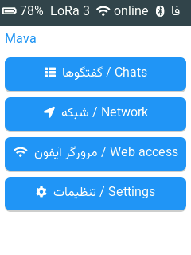
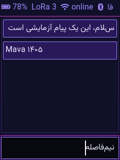
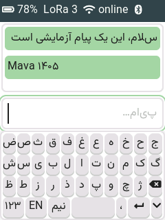
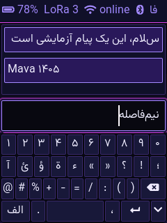
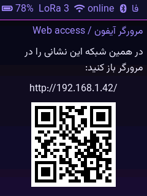

# Mava handheld — prototype hardware

The Mava board (board.md: ESP32-S3-N16R8 + SX1262, LoRa on the Meshtastic backbone, BLE,
USB, Wi-Fi relay, setup hotspot) built into a handheld with a 2.4" touch screen, WM8960 audio
for calls, and a keyboard driven by a separate **keyboard module** (an RP2040). Three
versions differ only in the keyboard module:

| Version | Keyboard | Pointing | Keyboard module firmware |
|---|---|---|---|
| **A** | our own 7 × 7 diode matrix (§5) | touch screen | `firmware/keyboard`, env `kb_matrix` |
| **B** | original BlackBerry Bold 9900 keyboard (§6) | touch screen | env `kb_bb9900` |
| **C** | BlackBerry 9900 keyboard + its optical trackpad (§7) | trackpad (touch optional) | env `kb_bb9900tp` |

The ESP32-S3 runs one firmware for all three (`firmware`, env `mava_handheld_s3`): the module
says which keyboard it has. With no module at all it is the plain Mava board.

Schematic (all versions, every module): [handheld-schematic.pdf](../hardware/handheld/handheld-schematic.pdf).

Status: **designed; ESP32 and module firmware build; nothing has been assembled.** The UI
framework (§8), touch keyboard (§8) and browser access (§10) are described there.

## 1. Parts

| Part | What | Notes |
|---|---|---|
| MCU | ESP32-S3-WROOM-1-**N16R8** (or a DevKitC-1 N16R8) | GPIO 26–37: flash and octal PSRAM; 19/20: USB |
| Keyboard module | **Raspberry Pi Pico** (RP2040) | §3; scans the keyboard (and trackpad), I2C target 0x1F |
| LoRa | SX1262 module (TCXO 1.8 V, DIO2 = RF switch), e.g. Ebyte E22-900M22S | as board.md |
| Display | Hailege 2.4" **ILI9341** 240×320 SPI TFT, **XPT2046** resistive touch, microSD slot | own SPI bus. Short jumper **J1** for 3.3 V supply. |
| Audio | Waveshare **WM8960** Audio Board (SKU 15019) | I2C 0x1A + I2S. **No crystal: MCLK from the ESP32-S3.** On-board mic, 3.5 mm headphone jack, two 1 W class-D outputs |
| Loudspeaker | 8 Ω, 1 W, 20–28 mm, sealed box | WM8960 SPK left: ringing, hands-free |
| Earpiece | 32 Ω receiver | WM8960 SPK right: calls at the ear |
| Vibration motor | 10 mm coin motor + AO3400 N-FET + 1N4148 flyback | GPIO 38; silent ring |
| Keyboard A | 49 tactile switches + 49 × 1N4148W diodes | §5 |
| Keyboard B / C | BlackBerry Bold 9900 keypad (+ 9900 trackpad for C) | §6, §7 |
| Setup switch | latching slide switch | GPIO 14 to GND (board.md §2) |
| Fuel gauge | MAX17048 module | I2C 0x36 |
| Battery | 1S LiPo, 2000–3000 mAh, protected | |
| Charger | TP4056 + DW01 module, USB-C in | |
| 3.3 V | TPS63020 buck-boost module (2 A) | Wi-Fi + LoRa TX + speaker peaks ≈ 0.8 A |
| Power switch | slide switch, battery → buck-boost and Pico VSYS | |

## 2. ESP32-S3 pin map

| GPIO | Signal | To | Notes |
|---|---|---|---|
| 0 | BOOT button | button to GND | strap; free for nothing else |
| 1 | LoRa DIO1 | SX1262 | RTC pin: a packet wakes the chip |
| 2 | Navigation keys | resistor ladder (§4) | ADC1; nine keys on one pin for boards without the keyboard module |
| 3 | LCD SCK | ILI9341, XPT2046 T_CLK, microSD | strap (JTAG source, only with the eFuse set); the display's own SPI bus |
| 4 | LoRa BUSY | SX1262 | |
| 5 | Touch CS | XPT2046 T_CS | 10 k pull-up |
| 6 | Touch IRQ | XPT2046 T_IRQ | RTC pin: a touch wakes the chip |
| 7 | SD CS | display module's microSD | 10 k pull-up; media and backups |
| 8 | LoRa RESET | SX1262 NRESET | |
| 9 | LCD MISO | ILI9341 SDO, XPT2046 T_DO, microSD | display bus |
| 10 / 11 / 12 / 13 | LoRa CS / MOSI / SCK / MISO | SX1262 | FSPI pins; the radio's own bus |
| 14 | Setup switch | latching switch to GND | board.md §2 |
| 15 / 16 / 17 | LCD CS / RESET / DC | ILI9341 | CS: 10 k pull-up |
| 18 | LCD MOSI | ILI9341 SDI, XPT2046 T_DIN, microSD | display bus (40 MHz LCD, 2 MHz touch, 20 MHz SD) |
| 19 / 20 | USB D− / D+ | USB-C | host link to PCs and phones, flashing, log |
| 21 | Keyboard INT | keyboard module GP2 | RTC pin, pull-up; low while keys / motion are pending, wakes the chip |
| 38 | Vibration motor | AO3400 gate | 100 k to GND |
| 39 / 40 / 41 | I2S MCLK / BCLK / LRCK | WM8960 | MCLK = 256 × fs |
| 42 | I2S DIN | WM8960 ADCDAT (microphone) | |
| 43 / 44 | — | free (UART0) | debug console or an extension |
| 45 | I2S DOUT | WM8960 DACDAT (speaker / earpiece) | strap: low at reset — 100 k to GND |
| 46 | LCD backlight PWM | display LED / backlight switch (§4) | strap: low at reset — 100 k to GND |
| 47 / 48 | I2C SDA / SCL | WM8960 0x1A, MAX17048 0x36, keyboard module 0x1F, RTC 0x68 / 0x51 | 3.3 k pull-ups. On a DevKitC with its RGB LED on 48, remove the LED. |

The radio and the display have separate SPI buses, so a screen redraw never delays a LoRa
interrupt and the display can use DMA at full speed. The display, the radio, touch, SD card
and the setup switch all sit on the DevKitC's left header (3V3 … 14, 5V, GND), so a prototype
can be wired from one side; audio, keyboard INT, vibration and I2C are on the right header.

## 3. Keyboard module (RP2040)

A Raspberry Pi Pico scans the keyboard (debounced, `mesh::keys::Matrix`), reads the trackpad
in version C, drives the keyboard backlight, and is an I2C target for the ESP32-S3. The ESP32
applies the layout (`mesh::keys::Layout`), so layouts change without reflashing the module.
It frees 13 ESP32 GPIOs (the display's own bus, LoRa reset, touch IRQ, SD card, vibration).

| Pico pin | Signal | To |
|---|---|---|
| VSYS | power | battery rail after the power switch (the Pico makes its own 3.3 V) |
| GND | | GND |
| GP0 / GP1 | I2C target SDA / SCL | ESP32 47 / 48 (shared bus) |
| GP2 | INT (open drain, active low) | ESP32 GPIO 9 |
| GP3 – GP9 | rows R0–R6 | keyboard |
| GP10 – GP16 | columns C0–C6 | keyboard (C6 unused on the 9900) |
| GP17 | backlight PWM | gate of an AO3400 N-FET (100 k to GND) switching the keypad / trackpad LEDs |
| GP18 / GP19 | I2C controller SDA / SCL | trackpad (C), 3.3 k pull-ups |
| GP21 / GP22 | trackpad NRST / SHTDWN | trackpad (C) |

Protocol (`firmware/lib/meshkeys/src/kbproto.h`, host-tested): address 0x1F; register 0x00
ID (`'M' 'K' version variant`), 0x01 events (count + up to 15 bytes `pressed<<7 | row<<3 |
col`, popped by the read), 0x02 trackpad motion (dx, dy since the last read), 0x03 backlight
(write). INT is low while anything is pending. The module's USB serial prints every key
position (`key R<r> C<c> down`), which is how a keypad's flex order is found.

Flash it: hold BOOTSEL, plug the Pico in, copy `firmware/keyboard/.pio/build/<env>/firmware.uf2`.

## 4. Modules, pin by pin

**SX1262** — 3.3 V, GND, NSS→10, MOSI→11, SCK→12, MISO→13, BUSY→4, DIO1→1, NRESET→8; E22:
DIO2 drives the RF switch. Antenna on before transmitting.

**ILI9341 display (header J2, SD header J4)**

| Module pin | To |
|---|---|
| VCC / GND | 3.3 V (J1 shorted) / GND |
| CS / RESET / DC | GPIO 15 / 16 / 17 |
| SDI (MOSI) / SCK / SDO (MISO) | GPIO 18 / 3 / 9 |
| LED | GPIO 46 (see below) |
| T_CLK / T_DIN / T_DO | GPIO 3 / 18 / 9 (same bus) |
| T_CS / T_IRQ | GPIO 5 / 6 |
| SD_CS / SD_MOSI / SD_MISO / SD_SCK | GPIO 7 / 18 / 9 / 3 |

Backlight: the red 2.8" "TFT SPI 240x320 V1.2" module switches its backlight with its own
transistor (Q1): LED is a logic input, GPIO 46 drives it directly (off at reset, PWM dims
it). A module whose LED pin is the backlight supply (~40–60 mA) needs a switch instead: LED ←
drain of an AO3401 P-FET, source 3.3 V, gate 100 k to 3.3 V and pulled down by a 2N7002 driven
by GPIO 46 (100 k to GND).

**WM8960 Audio Board** — 3V3, GND; SDA/SCL → 47/48; CLK (BCLK) → 40; WS (LRCLK) → 41; DAC
data in → 45; ADC data out → 42; MCLK → 39 (set the module's MCLK pads so MCLK comes from the
header: Waveshare's manual shorts MCLK to the TX pad); SPK left → 8 Ω speaker, SPK right →
32 Ω earpiece; headphone jack → headset; on-board mic → calls. **Check the header names on
the silkscreen**: www.waveshare.com was not reachable from the build environment. Modes:
earpiece, speaker, headset (menu choice; the jack has no detect line wired).

**MAX17048** — on the cell (VCC/GND), SDA/SCL → 47/48.

**RTC module** — keeps the time while the board is off, so the relay's TLS certificate
checks out at once after boot (without it the first HTTPS waits for NTP or the relay's Date
header). A DS3231 module (or DS1307) with its coin cell: VCC → 3.3 V, GND, SDA → 47, SCL → 48
(address 0x68); the handheld's PCF85063A (0x51) works the same (a PCF8563 does not). The
firmware sets the clock from it at boot and writes network time (NTP, the relay, a phone's
HELLO) back to it; the log's `clock:` line says which. Without an RTC the clock starts at the
last time saved to flash or the build date (good enough for the certificate check, not
trusted for message times).

**Navigation keys** (no keyboard module; firmware `NAV_KEYS_PIN`, default GPIO 2) — nine
push buttons on one pin: 10 kΩ from 3.3 V to GPIO 2, and from GPIO 2 to GND one button each
through its resistor (5 % parts are fine):

| Key | Up | Down | Left | Right | OK | Back | Menu | 📞 Call | ⛔ End |
|---|---|---|---|---|---|---|---|---|---|
| Resistor to GND | 0 Ω (wire) | 1 kΩ | 2.2 kΩ | 4.7 kΩ | 6.8 kΩ | 10 kΩ | 15 kΩ | 22 kΩ | 39 kΩ |

One key at a time; arrows repeat while held. The board looks for the 10 kΩ pull-up at boot
(log: `navigation keys … found`); an open pin is ignored. Leave out keys you don't need.

**Touch calibration** — Settings → *Calibrate touch*: tap the centre of three yellow
crosses; the board saves an affine map from the raw XPT2046 readings to screen pixels
(`/touchcal`), which takes in any mirrored, swapped or rotated panel. Until then the defaults
fit the red "TFT SPI 240x320 V1.2" module, whose raw axes both run the other way
(`TOUCH_X_MIN 3880 / MAX 220`, `TOUCH_Y_MIN 3860 / MAX 260` in build_flags).

**Vibration** — motor between 3.3 V and the AO3400 drain, 1N4148 across the motor, gate ←
GPIO 38 through 100 Ω, 100 k to GND.

**Power**

```
USB-C ──VBUS──► TP4056 (+DW01) ──► LiPo ──► power switch ──┬──► TPS63020 ──3.3 V──► ESP32-S3, SX1262,
                                    │                       │                       ILI9341, WM8960, motor
                                    └──► MAX17048           └──► Pico VSYS (keyboard module)
USB-C D− / D+ ──► ESP32 GPIO 19 / 20 (ESD array at the connector)
```

## 5. Version A — our 7 × 7 matrix

49 positions on the module's 14 lines; a diode per key, **cathode to the column**, so any
keys can be held together (Alt + Shift, Shift + letter) without ghosting.

| | C0 | C1 | C2 | C3 | C4 | C5 | C6 |
|---|---|---|---|---|---|---|---|
| **R0** | ض q | ص w | ث e | ق r | ف t | غ y | ع u |
| **R1** | ه i | خ o | ح p | ج [ | چ ] | ش a | س s |
| **R2** | ی d | ب f | ل g | ا h | ت j | ن k | م l |
| **R3** | ک ; | گ ' | ظ z | ط x | ز c | ر v | ذ b |
| **R4** | د n | پ m | و , | ژ . | Space | ⌫ | ⏎ |
| **R5** | Shift | Alt | ▲ | ▼ | ◀ | ▶ | OK |
| **R6** | 📞 Answer / Call | ⛔ Hang up | Menu | Back | Vol + | Vol − | Sym (symbol picker) |

Letters sit on their **ISIRI 9147** positions (standard Persian keyboard), so the Latin
layer is QWERTY; ژ has its own key so all 32 letters are one press.

```
 [Menu]  [📞]       [▲]       [⛔]  [Back]
              [◀]  [OK]  [▶]
                    [▼]
 ض q  ص w  ث e  ق r  ف t  غ y  ع u  ه i  خ o  ح p  ج [  چ ]
  ش a  س s  ی d  ب f  ل g  ا h  ت j  ن k  م l  ک ;  گ '
 [Shift]  ظ z  ط x  ز c  ر v  ذ b  د n  پ م  و ,  ژ .  [⌫]
 [Alt] [Sym]      [        Space        ]           [⏎]
 side: [Vol+] [Vol−]     top edge: setup switch (OFF | ON)
```

| Input | Persian layer | Latin layer |
|---|---|---|
| key | the letter | the QWERTY character |
| Shift + key | آ on ا, ئ on ی, ؤ on و, ة on ه, ء on ژ | capitals |
| Shift + Space | ZWNJ (نیم‌فاصله) | space |
| Alt + top row (q … p) | ۱ … ۹ ۰ | 1 … 9 0 |
| Alt + other keys | ( ) ! ؟ - + = / : " ' * # @ % & _ < > ؛ ، . | ASCII ? ; , |
| **Alt + Shift** | → Latin | → Persian |

Alt and Shift work held, or tapped once for the next key.

## 6. Version B — BlackBerry 9900 keyboard

The original 9900 keypad (QWERTY or QWERTZ legends): 39 keys on **7 rows × 6 columns = 13
flex lines** (matrix from ZitaoTech's BB9900-USB-keyboard, QMK `info.json`), wired to the
module's rows R0–R6 and columns C0–C5. The keypad has no diodes; its layout keeps normal
combinations free of ghosting. Vol+ and Vol− side buttons are added on the module **with
diodes** (cathode to the column) at two of the three free positions.

| | C0 | C1 | C2 | C3 | C4 | C5 |
|---|---|---|---|---|---|---|
| **R0** | — (free; trackpad click in C) | W | G | S | L | H |
| **R1** | A | Q | R | E | O | U |
| **R2** | 📞 Call | 0 | F | ⇧ left | K | J |
| **R3** | ⛔ End | Space | C | Z (QWERTZ: Y) | M | N |
| **R4** | ⊞ BlackBerry (Menu) | Sym | T | D | I | Y (QWERTZ: Z) |
| **R5** | ↩ Back | Alt | V | X | $ | B |
| **R6** | *Vol + (module)* | *Vol − (module)* | ⇧ right | P | Del | ⏎ Enter |

The flex lines' order is not published: wire them to GP3–GP15, open the module's USB serial,
press each key, and swap wires until each prints the position above. The keypad's connector
part number is not given by the reference project: measure the flex (contacts, pitch) and
pick the receptacle, or solder fine wires to the flex for the prototype.

Persian on 26 letter keys (letters stay on their ISIRI positions):

| Key | Persian | Shift (Persian) | Alt (Persian) | Latin / Alt (printed) |
|---|---|---|---|---|
| Q W E R T Y U I O P | ض ص ث ق ف غ ع ه خ ح | ة on ه | U: **چ**, P: **ج**; W E R: ۱ ۲ ۳ | letters / # 1 2 3 ( ) _ - + @ |
| A S D F G H J K L | ش س ی ب ل ا ت ن م | ئ on ی, آ on ا | L: **گ**; S D F: ۴ ۵ ۶ | letters / * 4 5 6 / : ; ' " |
| Z X C V B N M | ظ ط ز ر ذ د پ | ء on ز | B: **ژ**; Z X C: ۷ ۸ ۹ | letters / 7 8 9 ? ! , . |
| $ | **و** | ؤ | — | $ |
| 0 | **ک** | — | ۰ | 0 |

Alt + Shift switches language; Alt and Shift work held or tapped once (BlackBerry style);
Shift + Space = ZWNJ. **Sym** tapped opens the symbol picker; **Sym held**: E S D F are
▲ ◀ ▼ ▶ and Enter is OK. Persian stickers go on the keycaps.

## 7. Version C — BlackBerry 9900 keyboard + trackpad

Version B plus the 9900's optical trackpad (Avago **ADBS-A320**, I2C 0x3B, product ID 0x83,
motion 0x02 bit 7, ΔX 0x03, ΔY 0x04) on the **module's own I2C bus**. It moves the selection
(and the cursor in text); pressing it is OK. The touch panel may stay connected.

| Trackpad pin | Function | To |
|---|---|---|
| 1 / 2 | dome switch | module R0 (GP3) / diode → C0 (GP10): matrix position (0,0) |
| 3 / 4 | backlight LED − / + | 200 Ω → backlight FET drain / 3.3 V |
| 5 | DVDD | **1.8 V** LDO (XC6206P182 or AP2112K-1.8) |
| 6 | VDDA / VDDIO / VLED+ | 3.3 V |
| 7, 12 | GND | GND |
| 8 | NRST | GP21 |
| 9 / 11 | SDA / SCL | GP18 / GP19 (3.3 k pull-ups) |
| 10 | MOTION_N | not connected (polled) |
| 13 | SHTDWN | GP22 |

Connector: 13-contact 0.3 mm dual-row flex → **Hirose FH35C-17S** (Kapton behind the thin
flex). Don't swap 1.8 V and 3.3 V: the sensor then answers at 0x33.

Sources for §6–§7: ZitaoTech, *BB9900-USB-keyboard*; stolen, *blackberry_trackpad*.

## 8. UI and touch keyboard

`firmware/src/ui` (LVGL 9.2): status bar (battery, LoRa neighbours, Wi-Fi / relay, BLE / USB
host, typing language), **Home** → Chats · Network · Web access · Settings, a **chat** screen
with history and an input line, **Network** (node status), **Web access** (address and QR
code an iPhone on the same Wi-Fi opens, docs/web-access.md) and **Settings** (device
password, BLE passkey). Persian is shaped and laid out right-to-left by LVGL; the font is
**Vazirmatn** 16 px (`src/ui/fonts`, SIL OFL) with Montserrat for symbols.
`scripts/patch_lvgl.py` fixes two LVGL 9.2 bugs at build time: Persian digits laid out
right-to-left (۱۴۰۵ shown as ۵۰۴۱) and ۲ drawn as ۰.

Input:

- **Keyboard module** (A, B, C): typed text goes into the focused field; ▲ ▼ move between
  items, OK / Enter selects; Menu = Home, Back / ⛔ = back, 📞 = call, Vol ± = brightness.
- **Trackpad** (C): moves the selection; pressing it is OK.
- **Touch keyboard** (`lib/meshui/src/osk.*`, host-tested): Persian (32 letters in ISIRI
  order on three rows, ZWNJ key «نیم»), Latin QWERTY with one-shot Shift, and symbol pages
  with Persian or Latin digits and آ ئ ؤ ة ء « » ؟ ؛ ،. It opens by itself when there is no
  keyboard module, or when the text field is tapped; **Sym** on a hardware keyboard opens it
  on the symbol page.

The screen sleeps after 60 s without input; any key or touch wakes it.

**The handheld's own messenger** (0.1.1-beta16, `firmware/lib/meshclient`, host-tested): a
user identity of its own (`/cl-seed` on LittleFS, separate from the node's), contacts and
conversations on flash (100 messages per chat), and the apps' protocol byte for byte:
DATA end-to-end encrypted with Noise K / X (`e2e.*`, checked against core/e2e through the
`e2e` vectors in spec/test-vectors), compact Persian text (`textenc.*`, the `text` vectors),
fragments up to 16 LoRa frames and reassembly, signed RECEIPTs (the ✓ on sent messages),
ANNOUNCEs with its nickname every 30 min once the clock is known. It is a host of the node
on its own port (`Node::kLocalPort`, store sink `kSinkLocal`): it sees every packet the
node carries and its packets go out on LoRa, the Bluetooth mesh, USB and the relay.

On the screen: *Chats* lists the people it talks to and, below, people heard nearby (their
announces, "· نزدیک"); *My contact* shows its contact link as a QR code (the apps' *Add
contact → scan*); a chat refreshes when messages or receipts arrive. The first message to
someone uses Noise X; once they have written back, Noise K. `ui::stub_messenger()` (local
notes) remains for the PC simulator.

Screens rendered by the same code on a PC (`make -C firmware uishots`, after `pio run`):

| Home | Chat, hardware keyboard | Touch keyboard (Persian) | Symbols | Web access |
|---|---|---|---|---|
|  |  |  |  |  |

## 9. Calls and video

- **Voice:** Wi-Fi only (LoRa can't carry voice). Opus 16 kHz, 20 ms frames, WM8960 at
  16 kHz, I2S full duplex (docs/calls.md §7).
- **Video, best case: receive only.** The handheld offers a receive-only H.264 stream with
  `max 240 × 180, 10 fps` (calls.md stream caps), decoded in software into PSRAM. 5–10 fps
  expected, to be measured. The Android sender must honour the receiver's caps (it does not
  yet).

## 10. Browser access

iPhones (no App Store) and any other device on the same Wi-Fi use Mava in the browser,
served by the board: [web-access.md](web-access.md). The handheld's *Web access* screen
shows the address and a QR code.

## 11. Bring-up order

1. Power path: 3.3 V under 1 A, charger, MAX17048 over I2C.
2. Keyboard module alone on USB: key positions print; then on the I2C bus with the ESP32
   (`keyboard module: …` in the ESP32's log, key actions logged).
3. SX1262: LoRa against a Meshtastic node.
4. ILI9341 + backlight, touch, microSD on the display bus.
5. WM8960: I2C probe at 0x1A, tone on each speaker driver, mic loopback.
6. Trackpad (C): `ID 0x83` on the module, motion in the ESP32 log.
