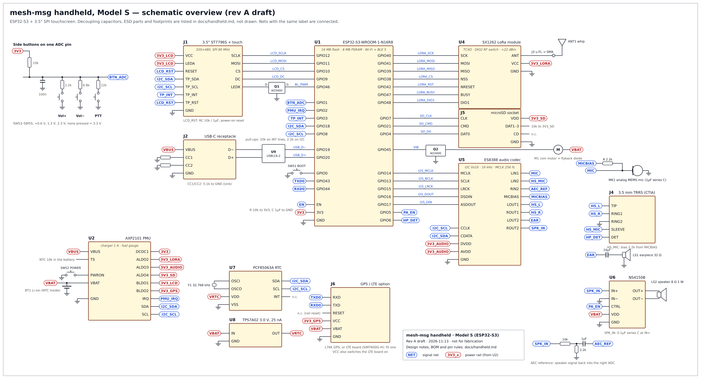
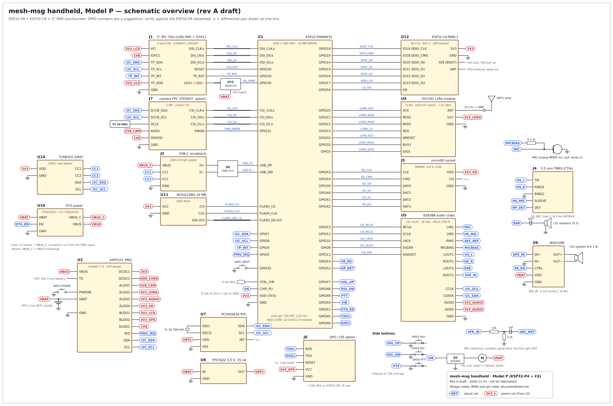

# Handheld device — hardware design

A device that does what the Android app does without a phone: a touchscreen with an
on-screen keyboard (like a smartphone), a microphone, an earpiece, a loudspeaker and a headset
jack, plus Wi-Fi, Bluetooth, LoRa and 4G LTE (built into Model P, an add-on board for Model S). This document covers **hardware only**; the firmware for
it is out of scope here.

There are **two models** that share the radio, audio, power and clock design:

| | **Model S** — low cost | **Model P** — phone |
|---|---|---|
| Processor | ESP32-S3 module (Wi-Fi 4 + BLE 5 built in) | ESP32-P4 (400 MHz, 32 MB PSRAM) + ESP32-C6 module for Wi-Fi 6 + BLE 5 |
| Screen | 3.5" IPS 320×480, capacitive touch | 5" IPS 720×1280, capacitive multi-touch |
| On-screen keyboard | keys about 4.5 mm wide upright, 9 mm sideways | keys about 6 mm wide upright, like a phone |
| **LoRa (built in)** | SX1262 module on the main board, SPI to the ESP32-S3; SMA antenna on the top edge | SX1262 module on the main board, SPI to the ESP32-P4; SMA antenna on the top edge |
| **4G LTE (SIM7600G-H)** | add-on LTE board on the GPS/LTE connector: mobile data + SMS | **built in**: mobile data, phone calls on the cellular network, SMS, GNSS (GPS) — a nano-SIM like a phone |
| Camera | none | optional 5 MP (photos, round video messages) |
| USB | USB-C, charging + flashing | USB-C, charging + flashing + host (USB keyboard, USB stick) |
| Battery | 2500 mAh | 4500 mAh |
| Size | about 62 × 110 × 14 mm (16 mm with the LTE board) | about 72 × 150 × 13 mm |
| Parts cost at 10 units | about 55–70 USD (+ about 50 with the LTE board) | about 125–150 USD |
| Schematic | [handheld-s-schematic.svg](images/handheld-s-schematic.svg) | [handheld-p-schematic.svg](images/handheld-p-schematic.svg) |

Both models are complete LoRa nodes on their own: the radio is built in, no external node or
phone is needed (§1 "LoRa", U4 in both schematics).

Physical buttons on both: **power** (on the PMU), **Vol+**, **Vol−** and **push-to-talk** on
the sides. Everything else is on the touchscreen.

Design rules for both:
- **Same LoRa chip and PMU as the existing boards** (SX1262, AXP2101 as on the T-Beam
  Supreme), so `firmware/lib/` (router, MAC, store, node) runs on either model unchanged
  and the device is an ordinary node on the LoRa mesh.
- **Pre-certified radio modules** (ESP32-S3 / ESP32-C6 modules, LoRa module). No RF layout of
  our own except the antenna feeds.
- **Every part is available from normal distributors (LCSC, Mouser, DigiKey)** and can be
  assembled by JLCPCB/PCBWay.

The schematics are generated by `scripts/handheld-schematic.py` (`s` or `p`); change the
script, not the SVGs. They show every block and every connection between blocks, with nets
connected by label. Decoupling, ESD parts and footprints are not drawn. They are overviews
to draw the real schematics from in KiCad, not fabrication drawings.

## 1. Shared blocks (both models)

| Block | Part | Why |
|---|---|---|
| LoRa | **SX1262 module** with TCXO (1.8 V), RF switch driven by DIO2, up to +22 dBm, u.FL output. Candidates: Ebyte E22-900M22S / E22-400M22S, Seeed Wio-SX1262. Check the RF-switch wiring of the chosen module. | Same chip as all four supported boards, so the same `radio.cpp` and presets. One SKU per band: 868/915 MHz or 433 MHz. |
| Audio codec | **Everest ES8388** (I2S data + I2C control) | Two ADC channels: one for the microphone, one for a hardware echo-cancellation reference. Two pairs of output drivers that can drive an earpiece and a headset directly. Built-in mic bias and PGA. Drivers in ESP-ADF. |
| Speaker amp | **NS4150B** class-D, 3 W, with a shutdown pin | Hands-free and ringtone. Runs from the battery; off unless the speaker is in use. |
| Microphone | Analog MEMS mic, bottom port, −38 dBV or better | ES8388 LIN1. |
| Earpiece | 32 Ω receiver | Private calls held to the ear, ES8388 LOUT2. |
| Loudspeaker | 8 Ω 1 W enclosed box speaker | NS4150B from ES8388 ROUT2. |
| Headset | 3.5 mm TRRS jack (CTIA) with a detect switch | Stereo from OUT1, headset mic to LIN2, detect switch to a GPIO. |
| PMU | **X-Powers AXP2101** | Already supported in the firmware (`HAS_PMU_AXP2101`). Linear charger up to 1 A, coulomb-counter fuel gauge, power key with long-press off, DC-DCs and LDOs so each block can be powered down completely. |
| RTC | **NXP PCF85063A** + 32.768 kHz crystal, supplied straight from the battery through a nanopower LDO (TPS7A02, 25 nA) | Keeps correct time while the device is off or flat. Call offers and message expiry use absolute times (GitHub issue #2, cause 3), and a device without internet can't sync its clock. |
| Storage | microSD socket | Photos, voice notes and backups. |
| Haptics | 10 mm coin vibration motor, N-MOSFET, flyback diode | Silent ring. |
| Options (Model S) | Quectel L76K GPS **or** the LTE board with a SIMCom SIM7600G-H (§2) on UART0 | GPS for location sharing; LTE reaches a relay anywhere without Wi-Fi. Fit one. Model P has the SIM7600G-H built in, with GNSS, so it needs neither (§3). |

There is no hardware Opus chip on the market worth using. The ES8388 is the converter
(ADC/DAC); Opus encoding and decoding run on the main processor at 16 kHz with 20 ms frames,
as in docs/calls.md §7. That is a fraction of one core on either processor.

### Audio path

```
 MEMS mic ──────────── LIN1 ┐
 headset mic (TRRS) ── LIN2 ┤ L-ADC ──┐
                            │         ├── I2S ──▶ processor: AEC, noise suppression,
 DAC loopback (÷) ──── RIN2 ┘ R-ADC ──┘                    Opus encode (16 kHz, 20 ms)
                                         ES8388
 processor: Opus decode ── I2S ──▶ DAC ┬─ LOUT1/ROUT1 ── TRRS headset (stereo)
                                       ├─ LOUT2 ──────── 32 Ω earpiece
                                       └─ ROUT2 ──────── NS4150B ── 8 Ω speaker
```

- **Echo cancellation reference:** ROUT2 is fed back through a resistor divider and a
  coupling capacitor into RIN2, so the right ADC channel records exactly what goes to the
  speaker. Espressif's AFE (ESP-SR) uses it as the AEC reference; it matters most in
  hands-free mode.
- **Modes**, chosen by the firmware: *earpiece* (LOUT2 on, amp off), *speaker* (ROUT2 + amp on),
  *headset* (OUT1, mic from LIN2; automatic on the jack detect pin).
- **Layout:** analog ground under the codec joined to the main ground at one point; the
  class-D outputs routed as a short, tight pair straight to the speaker, away from the mic
  trace; an RC filter on the codec's supply; the mic port sealed with a gasket.

### Side buttons

Vol+, Vol− and PTT. On Model S they share one ADC pin through a resistor ladder (10 k pull-up;
2.2 k, 6.8 k and 22 k to ground give about 0.6 V, 1.3 V and 2.3 V). On Model P each has its
own GPIO. The power key goes to the AXP2101 PWRON pin on both: short press wakes, long press
powers off, a 10 s press forces off.

### Radio and antennas

- **LoRa:** u.FL to an SMA bulkhead on the top edge with a quarter-wave whip (868/915 MHz about
  8 cm, 433 MHz about 17 cm), or a flat internal FPC antenna at a loss of several dB.
- **2.4 GHz:** the module's PCB antenna at the opposite top corner, at the board edge, with the
  module datasheet's copper keep-out on every layer and no battery, screen frame or metal
  under it. The case must be plastic there.
- **LoRa does not carry voice** (airtime and duty-cycle limits); calls need Wi-Fi or LTE.

## 2. Model S — ESP32-S3, 3.5" touchscreen



| Block | Part | Why |
|---|---|---|
| MCU + Wi-Fi + BLE | **ESP32-S3-WROOM-1-N16R8** (PCB antenna) | The existing firmware already targets the S3. Its vector instructions handle Opus at 16 kHz. 8 MB PSRAM holds the message cache, image decoding and two frame buffers; 16 MB flash holds firmware (two OTA slots) and LittleFS. Native USB. Flash encryption, secure boot and the eFuse HMAC key. |
| Screen | **3.5" IPS, 320×480, ST7796S**, SPI, with a **capacitive touch panel** (FT6336U or GT911, I2C) | The largest screen the S3 can drive over SPI with the pins it has left. 80 MHz SPI: about 15 fps full-screen, enough for a chat UI that redraws only what changes. |
| LoRa | **SX1262 module, built in** (§1), on its own SPI bus: GPIO 40 SCK, 41 MOSI, 39 MISO, 38 CS, 42 RST, 47 BUSY, 48 DIO1 | Powered from AXP2101 ALDO2. |
| Storage | microSD, SDMMC 1-bit | D1–D3 pulled up. |
| Battery | 2500 mAh LiPo pouch with NTC | |

Wi-Fi and Bluetooth share one 2.4 GHz radio on the S3 and take turns; during a Wi-Fi call,
Bluetooth mesh throughput drops.

### ESP32-S3 pin map

The N16R8 module uses GPIO 26–37 for flash and octal PSRAM, so 33 GPIOs remain. Strapping
pins (0, 3, 45, 46) only get signals that are low or floating at reset.

| GPIO | Signal | Notes |
|---|---|---|
| 0 | BOOT button | strap; button to GND, 10 k pull-up |
| 1 | Side buttons (ADC1_CH0, resistor ladder) | Vol+, Vol−, PTT; polled every 20 ms while awake |
| 2 | AXP2101 IRQ | open-drain, pull-up; charger, power key, low battery; wakes from sleep |
| 3 | Touch INT | strap (JTAG source, only if the eFuse is set); pull-up; wakes from light sleep |
| 4 | SD D0 | 10 k pull-up |
| 5 | Speaker amp enable | 100 k pull-down: amp off at boot (no pop) |
| 6 | Headset detect | pull-up; low when a plug is in |
| 7 | SD CLK | |
| 8 | I2C SCL | 2.2 k pull-up; PMU, codec, touch, RTC |
| 9 | LCD DC | |
| 10 / 11 / 12 | LCD CS / MOSI / SCLK | FSPI native pins, 80 MHz |
| 13 / 14 / 15 | I2S BCLK / MCLK / LRCK | MCLK 256 × fs |
| 16 / 17 | I2S DOUT → codec / DIN ← codec | |
| 18 | I2C SDA | 2.2 k pull-up |
| 19 / 20 | USB D− / D+ | USBLC6-2 ESD at the connector |
| 21 | SD CMD | 10 k pull-up |
| 38 / 39 / 40 / 41 | LoRa CS / MISO / SCK / MOSI | |
| 42 | LoRa RST | |
| 43 / 44 | UART0 TX / RX | debug console, or GPS / LTE option |
| 45 | Vibration motor gate | strap: must be low at reset, 100 k pull-down |
| 46 | LCD backlight gate (PWM) | strap: must be low at reset, 100 k pull-down |
| 47 / 48 | LoRa BUSY / DIO1 | |

Every usable pin is taken. The screen and touch reset lines are not on a GPIO: an RC
(10 k / 1 µF) resets them each time the AXP2101 switches their rail on, and the ST7796S also
takes a software reset command. The GPS/LTE option is reset by switching its rail.

### Model S power (estimates from datasheets, to be measured)

| State | Current at 3.8 V |
|---|---|
| Off (RTC only) | < 5 µA |
| Standby: screen off, BLE duty-cycled, LoRa listening | 8–15 mA |
| Screen on, idle | 100–150 mA |
| Voice call over Wi-Fi, earpiece, screen off | 200–280 mA |

With 2500 mAh: about 7–12 days standby, 9–12 hours talk.

### Model S LTE board (option)

Model S has no free pins for a modem's control and audio lines, so LTE comes as a small board
that plugs into J6 (the GPS/LTE connector) and carries everything the modem needs:

- **SIMCom SIM7600G-H** (same module as Model P, §3), nano-SIM holder with ESD protection,
  u.FL connectors for the main, diversity and GNSS antennas.
- **Power:** straight from the battery (J6 has a VBAT pin) through a 4 A load switch with
  470 µF + 100 µF bulk capacitors for the 2 A transmit peaks. The switch is enabled by the
  3V3_GPS rail (AXP2101 BLDO2): switching that rail on powers the modem, and an RC on PWRKEY
  turns it on by itself, so no extra GPIO is needed.
- **Logic levels:** the modem's I/O is 1.8 V; a TXS0104E on the board shifts UART TX/RX to
  3.3 V.
- **What works:** mobile data (PPP over UART0 at up to 3 Mbaud, with CMUX so AT commands and
  SMS run beside it) and SMS. **Not** cellular phone calls: the modem's PCM audio would need
  four more ESP32-S3 pins. App voice calls over LTE data work.
- Battery life with the modem registered on the network drops to about 3–5 days standby.

### Model S BOM (approx. USD at 10 units)

| Item | USD |
|---|---|
| ESP32-S3-WROOM-1-N16R8 | 4.5 |
| SX1262 LoRa module | 6–9 |
| 3.5" IPS ST7796S with capacitive touch | 9–13 |
| AXP2101, ES8388, NS4150B | 3 |
| RTC, crystal, TPS7A02 | 1.2 |
| Mic, earpiece, speaker, TRRS jack, side buttons | 4 |
| microSD, USB-C, SMA + whip, u.FL pigtail | 4 |
| Battery 2500 mAh | 5 |
| *LTE board option: SIM7600G-H, SIM holder, load switch, shifter, 3 antennas* | *about 50* |
| Passives, ESD, MOSFETs, motor | 4 |
| 4-layer PCB + assembly (share of a batch) | 10–15 |
| Printed case | 5–10 |
| **Total** | **about 55–70** |

## 3. Model P — ESP32-P4 + ESP32-C6, 5" touchscreen



| Block | Part | Why |
|---|---|---|
| Main processor | **ESP32-P4NRW32** (dual-core RISC-V 400 MHz, 32 MB PSRAM in the package) + **16 MB QSPI flash** (W25Q128JV) | MIPI-DSI and MIPI-CSI, a 2D graphics engine (PPA) and a hardware H.264 encoder, so a phone-like UI and round video messages are possible. 55 GPIOs, so no pin shortage. Flash encryption and secure boot as on the S3. |
| Wi-Fi + BLE | **ESP32-C6-MINI-1** module over SDIO (4-bit) | The P4 has no radio. The C6 adds Wi-Fi 6 and BLE 5 through ESP-Hosted (Wi-Fi and Bluetooth HCI over SDIO), as on Espressif's ESP32-P4 Function EV board. |
| Screen | **5" IPS, 720×1280, MIPI-DSI 2-lane** (e.g. ILI9881C or JD9365 driver), **GT911** capacitive multi-touch on I2C | Phone-sized text and keyboard. The DSI link and the P4's DMA2D keep full-screen redraws smooth. |
| Backlight | **SGM3732** (or TPS61160) LED boost, PWM dimming | A 5" panel's LED string needs about 15–20 V. |
| Camera (option) | **OV5647** 5 MP MIPI-CSI 2-lane module on an FPC, own 24 MHz oscillator | Photos and round video messages (the Android app has both). H.264 encoding in hardware. |
| USB | USB-C on the P4's **USB 2.0 high-speed OTG** port, **TUSB320** CC logic (dual role) and a **5 V boost + load switch** (TPS61023 + TPS22918) for host mode | Charging and flashing, and as host: a USB keyboard or a USB stick. In host mode the boost feeds the connector (VBUS_C) and a second load switch cuts the connector from the PMU's VBUS input, so the PMU never charges from its own boost. |
| LoRa | **SX1262 module, built in** (§1), on the P4's SPI: GPIO 20 SCK, 21 MOSI, 22 MISO, 23 CS, 32 RST, 33 BUSY, 3 DIO1 (a low-power GPIO, so a received packet wakes the P4) | On the P4, not the C6: the C6 only serves Wi-Fi and Bluetooth. Powered from AXP2101 ALDO2. |
| Storage | microSD on the P4's SDMMC slot 0, 4-bit | Fast media storage. |
| Cellular | **SIMCom SIM7600G-H** (LTE Cat-4 global bands, 3G/2G fallback, GNSS), nano-SIM, details below | Makes Model P a phone that works anywhere there is a mobile network: data for relays and app calls, cellular phone calls and SMS, and GPS. |
| Battery | 4500 mAh LiPo pouch with NTC | Sized for the modem's peaks (2 A in 2G) as well as the screen. |

Wi-Fi (on the C6), LoRa (SX1262) and cellular (SIM7600G-H) are separate radios, and the C6's
2.4 GHz radio is time-shared between Wi-Fi and Bluetooth as on the S3.

### Cellular: SIM7600G-H

```
            1.8 V                         3.3 V
 SIM7600G-H ─ UART RXD/TXD/RTS/CTS ─┐                ┌─ GPIO45–48 (UART, PPP + CMUX)
            ─ PCM CLK/SYNC/DIN/DOUT ┴─ U17 TXS0108E ─┴─ GPIO49–51, GPIO2 (I2S1, call audio)
            ─ DTR, STATUS, RI, FLIGHTMODE ── U19 TXS0104E ─┐
            ─ PWRKEY, RESET ── NPN open-collector Q3/Q4 ───┴─ U18 TCA9535 I2C expander ── INT → GPIO6
            ─ VBAT ── 470 µF + 100 µF ── U20 load switch (4 A) ── battery
                                              └ EN: MDM_PWR_EN (expander) and SW56 cellular kill switch
            ─ USIM ── J8 nano-SIM + ESD
            ─ MAIN / DIV / GNSS antennas (u.FL → flex antennas inside the case)
```

- **Data:** PPP over the UART at up to 3 Mbaud with hardware flow control, with CMUX so AT
  commands, SMS and GNSS run beside the data link. Enough for messages, relay sync, app voice
  calls and photos; for faster media, the modem's USB could later go to the P4's full-speed
  USB port if that port is free on the final pin plan.
- **Cellular phone calls:** the modem's PCM audio (8 or 16 kHz) goes to the P4's second I2S
  port (I2S1, P4 as slave). The P4 mixes it into the ES8388 path, so cellular calls use the same
  earpiece, speaker, headset and echo cancellation as app calls.
- **Waking up:** RI (ring indicator) pulses on an incoming call or SMS; it reaches the P4 through
  the I2C expander's interrupt on GPIO6, a low-power GPIO, so it wakes the P4 from sleep. DTR
  lets the modem sleep between network pages.
- **Power:** straight from the battery through its own load switch (not through the AXP2101's
  power path), as in SIMCom's reference design; bulk capacitors at the module's VBAT pins for
  2 A peaks in 2G. The firmware turns the modem off below about 3.5 V battery.
- **Kill switch:** SW56, a small slide switch on the side, holds the load switch's enable low,
  so the modem has no power at all whatever the software does (§4).
- **Antennas:** three flex antennas inside the case — LTE main along the bottom edge (away from
  the LoRa antenna at the top and the head), diversity and GNSS along the top sides.
- **Prototype:** LilyGO's T-SIM7600G-H board (ESP32 + SIM7600G-H) is a ready-made way to bring
  up the modem firmware (PPP, CMUX, SMS, call audio) before the Model P board exists.

### Model P power rails (AXP2101)

| Rail | Output | Supplies |
|---|---|---|
| DCDC1 | 3.3 V | P4 I/O, C6 module, flash |
| DCDC2 | 1.1 V | P4 core, **only if** the chip revision needs an external core supply; check the ESP32-P4 hardware design guidelines |
| ALDO1 | 2.8 V | camera AVDD |
| ALDO2 | 3.3 V | SX1262 |
| ALDO3 | 3.3 V | ES8388 |
| ALDO4 | 3.3 V | microSD |
| BLDO1 | 3.3 V | screen VCI, touch |
| BLDO2 | 3.3 V | spare (off) |
| DLDO1 | 1.8 V | screen IOVCC, camera DOVDD |
| VBAT | 3.0–4.2 V | backlight boost, speaker amp, OTG boost, vibration motor, and the modem through its own load switch (not through the AXP2101) |

### ESP32-P4 pin plan

MIPI-DSI, MIPI-CSI, USB high-speed and the flash pins are dedicated pins on the P4. The GPIO
numbers below are **a suggestion** that follows Espressif's ESP32-P4 Function EV board where it
can (C6 on SDIO, microSD on slot 0). **Check them against the ESP32-P4 datasheet before
layout**, especially the strapping pins and the low-power GPIOs that can wake the chip.

| Signal | P4 pin | Notes |
|---|---|---|
| Screen | DSI_CLK±, DSI_D0±, DSI_D1± | 100 Ω differential pairs, length-matched |
| Screen reset / touch reset | GPIO28 / GPIO29 | |
| Backlight PWM | GPIO30 | to the boost's EN/PWM pin |
| Camera | CSI_CLK±, CSI_D0±, CSI_D1± | 100 Ω differential pairs |
| Camera power-down | GPIO31 | |
| I2C (PMU, codec, touch, RTC, camera, CC logic) | GPIO7 SDA, GPIO8 SCL | 2.2 k pull-ups |
| Touch INT / PMU IRQ / LoRa DIO1 | GPIO4 / GPIO5 / GPIO3 | low-power GPIOs, so they wake the chip |
| C6 SDIO | GPIO18 CLK, GPIO19 CMD, GPIO14–17 D0–D3 | to C6 IO19 CLK, IO18 CMD, IO20–23 D0–D3 |
| C6 enable (reset) | GPIO54 | |
| LoRa SPI | GPIO20 SCK, GPIO21 MOSI, GPIO22 MISO, GPIO23 CS | |
| LoRa RST / BUSY | GPIO32 / GPIO33 | |
| microSD (slot 0, 4-bit) | GPIO43 CLK, GPIO44 CMD, GPIO39–42 D0–D3 | |
| I2S to ES8388 | GPIO13 MCLK, GPIO12 BCLK, GPIO10 LRCK, GPIO9 DOUT, GPIO11 DIN | |
| Speaker amp enable / headset detect | GPIO53 / GPIO52 | |
| Modem UART (via U17) | GPIO45 TX, GPIO46 RX, GPIO47 RTS, GPIO48 CTS | to SIM7600G-H RXD, TXD, RTS, CTS |
| Modem PCM audio (I2S1, via U17) | GPIO49 CLK, GPIO50 SYNC, GPIO51 out, GPIO2 in | modem is the PCM clock master |
| I2C expander INT (U18 TCA9535) | GPIO6 | low-power GPIO: buttons, modem RI and SIM detect wake the P4 |
| BOOT button | GPIO35 (strap) | |
| USB | USB_DP / USB_DM (high-speed PHY) | 90 Ω differential pair, ESD at the connector |

The slower lines moved to **U18 TCA9535** (I2C, 16 I/O) so the modem's UART and PCM get real
GPIOs:

| TCA9535 | Signal | Notes |
|---|---|---|
| P0.0 | MDM_PWR_EN | modem load switch; 100 k pull-down, so the modem is off at reset |
| P0.1 / P0.2 | MDM_PWRKEY / MDM_RESET | through NPN open-collector Q3 / Q4 |
| P0.3 | MDM_DTR | via U19 |
| P0.4 / P0.5 | MDM_STATUS / MDM_RI | inputs, via U19; RI raises INT |
| P0.6 | VIB | vibration motor gate; 100 k pull-down |
| P0.7 | OTG_EN | 100 k pull-down |
| P1.0 / P1.1 / P1.2 | VOL_UP / VOL_DN / PTT | inputs with pull-ups, raise INT |
| P1.3 | SIM_DET | SIM holder's card-detect switch |
| P1.4 | MDM_FLIGHT | airplane mode, via U19 |
| P1.5–P1.7 | spare | |

### Model P power (estimates from datasheets, to be measured)

| State | Current at 3.8 V |
|---|---|
| Off (RTC only) | < 5 µA |
| Standby: screen off, C6 BLE duty-cycled, LoRa listening | 15–30 mA |
| Screen on, idle | 250–400 mA |
| Voice call over Wi-Fi, earpiece, screen off | 250–350 mA |
| Video recording with the screen on | 600–800 mA |
| Modem registered on LTE, idle (DTR sleep), added to standby | +3–6 mA |
| Mobile data active (LTE) | 300–700 mA |
| Cellular phone call, earpiece, screen off | 350–500 mA |
| Modem transmit peak (2G) | up to 2 A for a few ms |

With 4500 mAh: about 5–9 days standby with the modem off, 3–5 days with it registered;
8–12 hours of cellular or app calls; 8–12 hours of screen-on use.

### Model P BOM (approx. USD at 10 units)

| Item | USD |
|---|---|
| ESP32-P4NRW32 + 16 MB flash + 40 MHz crystal | 8 |
| ESP32-C6-MINI-1 | 3 |
| SX1262 LoRa module | 6–9 |
| 5" 720×1280 MIPI IPS with GT911 touch | 14–20 |
| Backlight boost, OTG boost + load switch, TUSB320 | 3 |
| AXP2101, ES8388, NS4150B | 3 |
| RTC, crystal, TPS7A02 | 1.2 |
| OV5647 camera module (option) | 5–8 |
| Mic, earpiece, speaker, TRRS jack, side buttons | 4 |
| microSD, USB-C, SMA + whip, u.FL pigtail | 4 |
| SIMCom SIM7600G-H | 35–45 |
| Modem support: TXS0108E, TXS0104E, TCA9535, load switch, bulk capacitors, nano-SIM holder + ESD, kill switch | 5 |
| 3 flex antennas (LTE main, diversity, GNSS) | 4–6 |
| Battery 4500 mAh | 8 |
| Passives, ESD, MOSFETs, motor | 5 |
| 6-layer PCB + assembly (share of a batch) | 15–20 |
| Printed case | 5–10 |
| **Total** | **about 125–150** |

**PCB:** 6 layers (signal / ground / signal / power / ground / signal) for the P4's 0.4 mm
pitch package and the MIPI and USB high-speed pairs; impedance control from the board house.
This is the harder board of the two. If chip-level P4 layout is too much for the first
prototype, a third-party P4 + C6 core module can be used on a simpler carrier board.

## 4. Security-related hardware (both)

- **Flash encryption** and **secure boot v2**, burned at provisioning; the identity key sealed
  with the eFuse **HMAC** key so a copy of the flash is useless on another device.
- **JTAG disabled by eFuse** in production units.
- Panic wipe (M6): a held combination of Vol− + PTT + power, read by the firmware.
- **Cellular privacy:** a SIM and the modem's IMEI identify the device to the mobile operator,
  and the network knows roughly where it is whenever the modem is on; SMS and cellular calls
  are not end-to-end encrypted. So the modem is **off by default**, the app shows clearly when
  it is on, and Model P's SW56 kill switch cuts its power in hardware. App messages and app
  calls over LTE data stay end-to-end encrypted like on any other network. In some countries a
  modem's IMEI must be registered with the regulator before local networks accept it.
- Model P's camera is on a power rail that the firmware switches off when not in use, and its
  power-down pin is held active by a pull-up/pull-down at reset.

## 5. Mechanical (both)

- Slab phone shape: screen on the front, earpiece slot above it, mic hole at the bottom, USB-C
  and headset jack at the bottom edge, SMA on the top, Vol+/Vol−/PTT on the left, power on the
  right, speaker grille on the back.
- The screen connects with an FPC to a ZIF connector; the battery with JST-PH; the speaker and
  earpiece with spring contacts or short wires.
- Prototype case: 3D-printed (PETG/ASA), with a glass or acrylic window over the screen if the
  panel has no cover glass. The 2.4 GHz antenna area must not be printed with carbon-filled
  filament.

## 6. Bring-up plan

1. **Software before custom boards:** Model S firmware can start on a ready-made ESP32-S3 3.5"
   touch board plus a Heltec V3 for LoRa; Model P on Espressif's ESP32-P4 Function EV board
   (P4 + C6, MIPI screen) with an SX1262 breakout; the modem on LilyGO's T-SIM7600G-H board.
2. **Model S rev A first** (4 layers, module-based, cheaper), then **Model P rev A** (6 layers).
   Both with test points, 0 Ω links on every rail and a UART header. Bring up in order: power
   and charging, USB flashing, screen and touch, LoRa (reuse `firmware/` with a new
   `platformio.ini` env and the pin table), audio, Wi-Fi/BLE; on Model P also camera and USB host.
3. **Measure:** the power tables above, LoRa range against a Heltec V3 node, audio (echo in
   speaker mode, earpiece level), antenna match. Fix in rev B.
4. **Certification**, only if devices are sold: the radio modules are pre-certified, but the
   finished device still needs EMC and radio testing (CE RED in Europe, FCC in the US), and
   868 MHz use must follow the regional duty-cycle rules the MAC already enforces.
