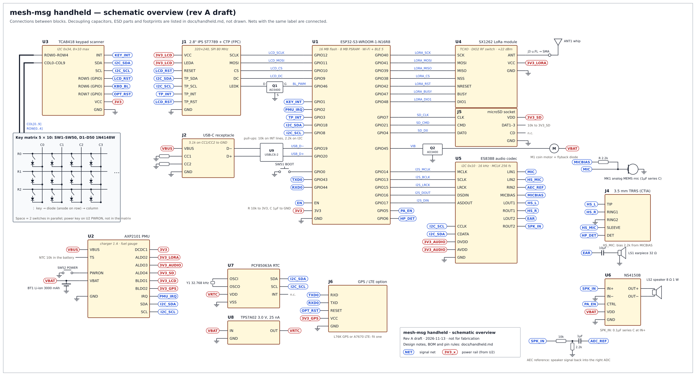

# Handheld device — hardware design

A pocket device that does what the Android app does without a phone. It has a QWERTY
keyboard with Persian legends, a colour screen, a microphone, an earpiece, a loudspeaker
and a headset jack, plus Wi-Fi, Bluetooth and LoRa. This document covers **hardware only**;
the firmware for it is out of scope here.

Design rules:
- **Same radio and PMU as the existing boards** (SX1262, AXP2101 as on the T-Beam
  Supreme), so `firmware/lib/` (router, MAC, store, node) runs on it unchanged and the
  device is an ordinary node on the LoRa mesh.
- **Pre-certified radio modules** (ESP32-S3 module, LoRa module). No RF layout of our own
  except the antenna feed.
- **Every part is available from normal distributors (LCSC, Mouser, DigiKey)** and can be
  hand-soldered or assembled by JLCPCB/PCBWay.

## 1. Schematic overview



Every block and every connection between blocks; nets with the same label are connected.
Decoupling, ESD parts and footprints are not drawn. The drawing is generated by
`scripts/handheld-schematic.py`; change the script, not the SVG. It is a design overview to
draw the real schematic from in KiCad, not a fabrication drawing.

### Block diagram

```
                        USB-C (5 V, data)
                            │
              ┌─────────────┴──────────────┐
  Li-ion ─────┤ AXP2101 PMU                │  charger 1 A, fuel gauge, power key,
  1S 3000 mAh │  DCDC1 3.3 V ── ESP32-S3   │  rails switched per block
              │  ALDO2 3.3 V ── SX1262     │
              │  ALDO3 3.3 V ── ES8388     │
              │  ALDO4 3.3 V ── microSD    │
              │  BLDO1 3.3 V ── LCD + touch│
              │  BLDO2 3.3 V ── GPS (opt.) │
              └─────────────┬──────────────┘
                            │ I2C
 ┌──────────────────────────┴───────────────────────────────────────────────┐
 │                        ESP32-S3-WROOM-1-N16R8                            │
 │      dual-core 240 MHz · 16 MB flash · 8 MB PSRAM · Wi-Fi 4 · BLE 5      │
 └──┬────────────┬──────────────┬──────────────┬─────────────┬─────────────┬┘
    │ SPI2       │ SPI3         │ I2S          │ I2C         │ SDMMC 1-bit │ USB
    │ 80 MHz     │              │              │             │             │
 ┌──┴───────┐ ┌──┴─────────┐ ┌──┴──────────┐ ┌─┴──────────┐ ┌┴─────────┐   │
 │ 2.8" IPS │ │ SX1262     │ │ ES8388      │ │ TCA8418    │ │ microSD  │  CDC /
 │ 320×240  │ │ LoRa module│ │ audio codec │ │ key matrix │ └──────────┘  flashing
 │ ST7789   │ │ TCXO, 22dBm│ │ 2 ADC 2 DAC │ │ 5×10 = 50  │
 │ + CTP    │ └──┬─────────┘ └┬─┬──┬──┬────┘ │ keys       │   I2C also: CST816/FT6336
 └──────────┘    │ u.FL      │ │  │  │      └────────────┘   touch, PCF85063A RTC
              SMA antenna    │ │  │  └─ NS4150B ── 8 Ω 1 W speaker
                             │ │  └──── 32 Ω earpiece receiver
                             │ └─────── 3.5 mm TRRS headset (mic + stereo)
                             └───────── MEMS microphone
```

## 2. Main parts

| Block | Part | Why |
|---|---|---|
| MCU + Wi-Fi + BLE | **ESP32-S3-WROOM-1-N16R8** (PCB antenna) | The existing firmware already targets the S3. Its vector instructions handle Opus at 16 kHz in software. 8 MB PSRAM holds the message cache, image decoding and the frame buffer; 16 MB flash holds firmware (two OTA slots) and LittleFS. Native USB for flashing and a serial console. Flash encryption, secure boot and the eFuse HMAC key protect the identity at rest. |
| LoRa | **SX1262 module** with TCXO (1.8 V), RF switch driven by DIO2, up to +22 dBm, u.FL output. Candidates: Ebyte E22-900M22S / E22-400M22S, Seeed Wio-SX1262. Check the RF-switch wiring of the chosen module. | Same chip as all four supported boards, so the same `radio.cpp` and presets. One SKU per band: 868/915 MHz or 433 MHz. |
| Screen | **2.8" IPS TFT, 320×240, ST7789**, SPI, with a **capacitive touch panel** (CST816S or FT6336U, I2C) | Large enough for Persian text with diacritics at a readable size. SPI on the S3's native FSPI pins runs at 80 MHz, about 30 fps full-screen. Touch is optional on the BOM but the footprint is always there. |
| Keyboard controller | **TI TCA8418** (I2C, up to 8 rows × 10 columns) | Scans, debounces and queues key events in hardware and raises an interrupt, so the MCU can sleep and wake on a key press. Uses 3 MCU pins instead of 15. Its unused rows work as GPIO outputs (§4). |
| Audio codec | **Everest ES8388** (I2S data + I2C control) | Two ADC channels: one for the microphone, one for a hardware echo-cancellation reference. Two pairs of output drivers that can drive an earpiece and a headset directly. Built-in mic bias and PGA. Widely used with ESP32 (LyraT) with drivers in ESP-ADF. |
| Speaker amp | **NS4150B** class-D, 3 W, with a shutdown pin | Hands-free and ringtone. Runs from the battery; off unless the speaker is in use. |
| Microphone | Analog MEMS mic, bottom port, −38 dBV or better | Connected to ES8388 LIN1. |
| Earpiece | 32 Ω receiver, 1511 or 1206 size | Private calls held to the ear, driven by ES8388 LOUT2. |
| Loudspeaker | 8 Ω 1 W enclosed box speaker, about 20 × 30 mm | Driven by NS4150B from ES8388 ROUT2. |
| Headset | 3.5 mm TRRS jack (CTIA) with a detect switch | Stereo from OUT1, headset mic to LIN2, detect switch to a GPIO. |
| PMU | **X-Powers AXP2101** | Already supported in the firmware (`HAS_PMU_AXP2101`). Linear charger up to 1 A, coulomb-counter fuel gauge, power key with long-press off, one DC-DC and nine LDOs, so each block can be powered down completely. |
| RTC | **NXP PCF85063A** + 32.768 kHz crystal, supplied straight from the battery through a nanopower LDO (TPS7A02, 25 nA) | Keeps correct time while the device is off or flat. Call offers and message expiry use absolute times (GitHub issue #2, cause 3), and a device without internet can't sync its clock. |
| Storage | microSD socket, push-push | Photos, voice notes and backups. SDMMC 1-bit mode; D1–D3 pulled up. |
| Battery | 1S Li-ion/LiPo 3000 mAh pouch with an NTC, JST-PH 2-pin (or an 18650 holder for the rugged variant) | See §6 for runtime. |
| Haptics | 10 mm coin vibration motor driven by an N-MOSFET, with a flyback diode | Silent ring. |
| Options | Quectel L76K GPS (UART0) **or** SIMCom A7670 LTE Cat-1 modem (UART0) | GPS for location sharing; LTE reaches a relay anywhere without Wi-Fi. They share UART0, so fit only one. With either fitted, the debug console moves to USB CDC. |

There is no hardware Opus chip on the market worth using. The ES8388 is the converter
(ADC/DAC); Opus encoding and decoding run on the S3 at 16 kHz with 20 ms frames, as in
docs/calls.md §7. That uses a fraction of one core; Espressif's `esp_audio_codec` ships an
Opus encoder and decoder for the S3.

## 3. Keyboard

A 5 × 10 matrix of 50 keys on TCA8418 rows 0–4 and columns 0–9, with a **1N4148W diode per
key** so any combination of keys reads correctly (needed for Shift/Fn chords and the panic
wipe combination planned in M6).

| | C0 | C1 | C2 | C3 | C4 | C5 | C6 | C7 | C8 | C9 |
|---|---|---|---|---|---|---|---|---|---|---|
| **R0** | Q ض | W ص | E ث | R ق | T ف | Y غ | U ع | I ه | O خ | P ح |
| **R1** | A ش | S س | D ی | F ب | G ل | H ا | J ت | K ن | L م | ⌫ |
| **R2** | Z ظ | X ط | C ز | V ر | B ذ | N د | M پ | ، و | . | ↵ |
| **R3** | Fn | ⇧ | Alt | Lang | Space | PTT (side) | Sym | 0 | Mic | Emoji |
| **R4** | Call | End | ◀ | ▶ | ▲ | ▼ | OK | Back | Vol+ | Vol− |

- Persian letters follow the standard Persian layout where it fits; the remaining letters
  (ج چ گ ک ژ ء and others) are on the Alt layer, and digits on Sym. The legends are printed
  on the keycaps, so the final assignment is set when the caps are ordered.
- Space is one wide cap over two switches wired in parallel to R3C4. Matrix position R3C5
  is then free and carries the **push-to-talk** key on the left side of the case.
- **Call** (green) and **End** (red) are on the keyboard; **Vol+/Vol−** are side keys on
  R4C8 and R4C9.
- **The power key is not in the matrix.** It goes to the AXP2101 PWRON pin: short press wakes,
  long press powers off, a 10 s press forces off.
- **Keyboard backlight:** 4–6 white 0603 LEDs under the keys, switched by a MOSFET from a
  spare TCA8418 row used as a GPIO (§4). It is on/off only; a PWM pin can be found later by
  dropping the GPS option.

**Building the keys:**
- *Prototype:* SMD tactile switches (3 × 4 mm, 160 gf) on the main PCB under a 3D-printed or
  resin keycap sheet with a flexible web.
- *Production:* a silicone rubber keypad with carbon pills over gold-plated interdigitated
  pads on the PCB (ENIG finish). It is quieter, thinner, cheapest at volume and needs one
  mould. Leave the pad geometry the same in both so the PCB serves both.

## 4. ESP32-S3 pin map

The N16R8 module uses GPIO 26–37 for flash and octal PSRAM, so 33 GPIOs remain. Strapping
pins are only given signals that are low or floating at reset.

| GPIO | Signal | Notes |
|---|---|---|
| 0 | BOOT button | strap; button to GND, 10 k pull-up |
| 1 | TCA8418 INT | open-drain, 10 k pull-up; wakes from light/deep sleep |
| 2 | AXP2101 IRQ | open-drain, pull-up; charger, power key, low battery |
| 3 | Touch INT | strap (JTAG source, only if the eFuse is set); pull-up |
| 4 | SD D0 | 10 k pull-up |
| 5 | Speaker amp enable (NS4150B CTRL) | 100 k pull-down: amp off at boot (no pop) |
| 6 | Headset detect (jack switch) | pull-up; low when a plug is in |
| 7 | SD CLK | |
| 8 | I2C SCL | 2.2 k pull-up; PMU, codec, keyboard, touch, RTC |
| 9 | LCD DC | |
| 10 | LCD CS | FSPI native pin |
| 11 | LCD MOSI | FSPI native pin |
| 12 | LCD SCLK | FSPI native pin, 80 MHz |
| 13 | I2S BCLK | |
| 14 | I2S MCLK | 256 × fs (4.096 MHz at 16 kHz) |
| 15 | I2S LRCK | |
| 16 | I2S DOUT → codec DAC | |
| 17 | I2S DIN ← codec ADC | |
| 18 | I2C SDA | 2.2 k pull-up |
| 19 / 20 | USB D− / D+ | native USB; USBLC6-2 ESD at the connector |
| 21 | SD CMD | 10 k pull-up |
| 38 | LoRa CS | |
| 39 | LoRa MISO | |
| 40 | LoRa SCK | |
| 41 | LoRa MOSI | |
| 42 | LoRa RST | |
| 43 / 44 | UART0 TX / RX | debug console, or GPS / LTE option |
| 45 | Vibration motor gate | strap (flash voltage): must be low at reset, 100 k pull-down |
| 46 | LCD backlight gate (PWM) | strap: must be low at reset, 100 k pull-down |
| 47 | LoRa BUSY | |
| 48 | LoRa DIO1 (IRQ) | |

Every usable pin is taken. The slow signals go on spare TCA8418 rows used as GPIO outputs:

| TCA8418 pin | Signal |
|---|---|
| ROW5 | LCD reset |
| ROW6 | keyboard backlight enable |
| ROW7 | GPS / LTE reset or power key (option) |

The RTC alarm output is not connected; the firmware reads the RTC at boot and at intervals.
If more pins are ever needed, the **ESP32-S3-WROOM-1-N16R2** (quad PSRAM, 2 MB) frees
GPIO 35–37, but 2 MB PSRAM is too small for this device; a PCA9535 I2C expander is the
better fix.

## 5. Audio path

```
 MEMS mic ──────────── LIN1 ┐
 headset mic (TRRS) ── LIN2 ┤ L-ADC ──┐
                            │         ├── I2S ──▶ ESP32-S3: AEC, noise suppression,
 DAC loopback (÷) ──── RIN2 ┘ R-ADC ──┘                 Opus encode (16 kHz, 20 ms)
                                         ES8388
 ESP32-S3: Opus decode ── I2S ──▶ DAC ┬─ LOUT1/ROUT1 ── TRRS headset (stereo)
                                      ├─ LOUT2 ──────── 32 Ω earpiece
                                      └─ ROUT2 ──────── NS4150B ── 8 Ω speaker
```

- **Echo cancellation reference:** ROUT2 is fed back through a resistor divider and a
  coupling capacitor into RIN2, so the right ADC channel records exactly what goes to the
  speaker. Espressif's AFE (ESP-SR) uses it as the AEC reference; this is the arrangement
  used on Espressif's own voice boards and matters most in hands-free mode.
- **Modes**, chosen by the firmware: *earpiece* (LOUT2 on, amp off), *speaker* (ROUT2 + amp on),
  *headset* (OUT1, mic from LIN2; automatic on the jack detect pin). Ringtones always use the
  speaker unless a headset is in.
- **Layout:** analog ground under the codec joined to the main ground at one point near the
  codec; the class-D outputs routed as a short, tight pair straight to the speaker, away from
  the mic trace; an RC filter on the codec's supply; the mic port sealed to its hole with a
  gasket so speaker sound doesn't leak inside the case into it.

## 6. Power

| State | Estimated current (3.8 V) |
|---|---|
| Off (RTC only) | < 5 µA |
| Standby: screen off, BLE duty-cycled, LoRa listening | 8–15 mA |
| Screen on, idle | 90–130 mA |
| LoRa transmit at +22 dBm | +120 mA during the packet |
| Voice call over Wi-Fi, earpiece | 200–280 mA |
| Voice call over Wi-Fi, speaker at full volume | up to 600 mA peaks |

These are **estimates from datasheets**, to be measured on the first prototype. With
3000 mAh: about 8–14 days of standby and 10–14 hours of talk time.

- LoRa listening is the largest standby cost (the SX1262 draws about 5 mA in continuous RX).
  The router's preamble-sniffing RX duty cycle can cut it, but that is a firmware choice.
- Charging over USB-C at up to 1 A (5.1 kΩ CC pull-downs, sink only), with the battery
  NTC on the AXP2101 TS pin.
- The AXP2101 powers down unused blocks (LCD, codec, SD, GPS) completely, not just their
  chips' sleep modes.

## 7. Radio and antennas

- **LoRa:** the module's u.FL connector goes to an SMA bulkhead on the top edge with a
  quarter-wave whip antenna (868/915 MHz about 8 cm, 433 MHz about 17 cm). A flat internal
  FPC antenna is an option for a smaller case, at a loss of several dB of range.
- **2.4 GHz:** the WROOM-1's PCB antenna at the opposite top corner, at the board edge, with
  the copper keep-out from the module datasheet on every layer and no battery or metal under
  it. The case must be plastic there.
- **Wi-Fi and Bluetooth share one 2.4 GHz radio** on the S3 and take turns. During a Wi-Fi
  voice call, Bluetooth mesh throughput drops; that is a firmware scheduling question, but it
  means the device can't be a strong Bluetooth relay during calls.
- **LoRa does not carry voice** (airtime and duty-cycle limits); calls need Wi-Fi (direct on
  the local network or through a relay) or the LTE option.

## 8. Security-related hardware

- ESP32-S3 **flash encryption** and **secure boot v2**, burned at provisioning; the identity
  key sealed with the eFuse **HMAC** key so a copy of the flash is useless on another device.
- **JTAG disabled by eFuse** in production units; USB serial console limited to signed firmware.
- Keyboard diodes allow a key chord for the panic wipe planned in M6 (deleting the keys and
  messages is firmware).
- No camera, so no photo or video capture; received photos display on the screen.

## 9. Mechanical

- Form factor like a BlackBerry: screen above the keyboard, landscape, about 70 × 125 ×
  18 mm with the 3000 mAh pouch.
- One 4-layer PCB, 1.6 mm, ENIG (needed for carbon-pill keypad pads). Stack-up:
  signal / ground / power / signal.
- The screen connects with an FPC to a ZIF connector; the battery with JST-PH; the speaker and
  earpiece with spring contacts or short wires.
- Openings: USB-C and headset jack at the bottom, SMA at the top, PTT and volume on the left,
  power key on the right, mic hole at the bottom front, earpiece slot above the screen, and
  speaker grille on the back.
- Prototype case: 3D-printed (PETG/ASA). The 2.4 GHz antenna area must not be printed with
  carbon-filled filament.

## 10. Approximate BOM (prices at 10 units)

| Item | Approx. USD |
|---|---|
| ESP32-S3-WROOM-1-N16R8 | 4.5 |
| SX1262 LoRa module | 6–9 |
| 2.8" IPS ST7789 with capacitive touch | 8–12 |
| AXP2101 | 1.5 |
| ES8388 + NS4150B | 1.5 |
| TCA8418 | 1.5 |
| PCF85063A + crystal + TPS7A02 | 1.2 |
| MEMS mic, earpiece, speaker, TRRS jack | 3 |
| 50 tact switches + 50 diodes | 3 |
| microSD socket, USB-C, SMA + whip, u.FL pigtail | 4 |
| Battery 3000 mAh with NTC | 6 |
| Passives, ESD, MOSFETs, LEDs, vibration motor | 4 |
| 4-layer PCB + assembly (share of a batch) | 10–15 |
| Case and keycaps (printed) | 5–10 |
| **Total** | **about 60–80** |

## 11. Bring-up plan

1. **Software before a custom board:** the LilyGO T-Deck (ESP32-S3, 2.8" 320×240 ST7789,
   keyboard, SX1262, mic and speaker) is close enough to start the firmware on. It has no
   earpiece, headset jack, RTC or codec with an AEC reference, so audio work waits for our board.
2. **Rev A board:** all blocks with test points, 0 Ω links on every rail, and a header for
   UART0. Bring up in order: power and charging, USB flashing, screen, keyboard, LoRa
   (reuse `firmware/` with a new `platformio.ini` env and this pin table), audio, Wi-Fi/BLE
   coexistence.
3. **Measure:** current in each state from §6, LoRa range against a Heltec V3 node, audio
   (echo in speaker mode, earpiece level), antenna match. Then fix the issues in Rev B and
   design the moulded keypad.
4. **Certification**, only if devices are sold: both radio modules are pre-certified, but the
   finished device still needs EMC and radio testing (CE RED in Europe, FCC in the US), and
   868 MHz use must follow the regional duty-cycle rules the MAC already enforces.
