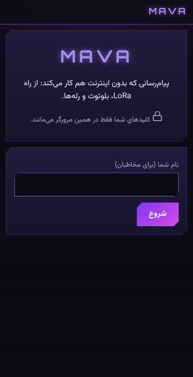
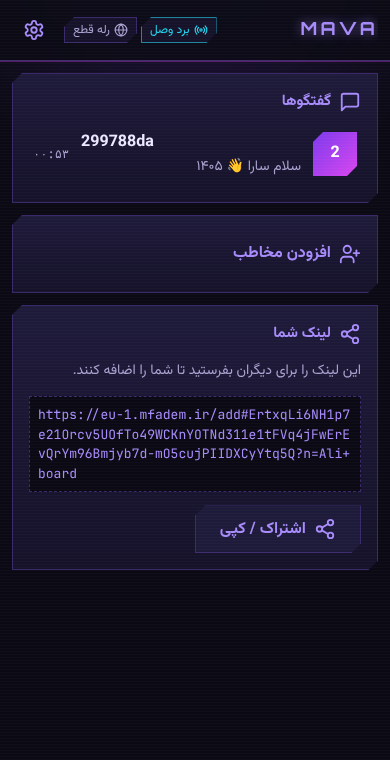
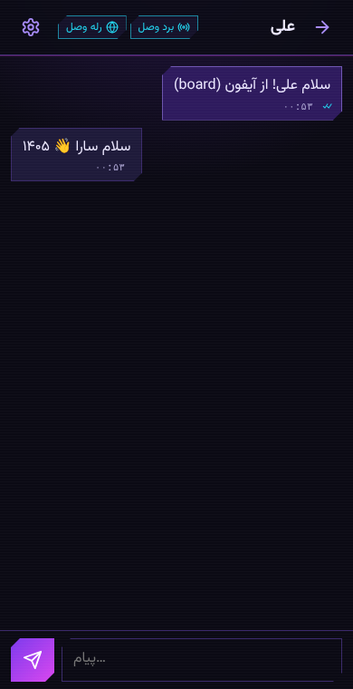

# Browser access (iPhones without the App Store)

The Mava app can't be published on Apple's App Store from where Mava's users are, so an
iPhone (or any phone or laptop) uses Mava **in the browser**, served by a Mava board or
handheld on the same Wi-Fi.

```
iPhone Safari ── Wi-Fi ──► Mava board / handheld  ──LoRa (Meshtastic)──► the mesh
   │   http://<board>/app/            │ host port 2 (/api/link)
   │   Go client in WebAssembly       └─Wi-Fi──► relay (the board's gateway session)
   └── HTTPS (when the phone has internet) ──► relays directly
```

## How it works

- **The client runs in the browser.** `web/lite` is the Mava core's identity, end-to-end
  encryption (Noise), message, announce and receipt code — the same Go packages as the apps
  — without core/node's SQL databases, compiled to WebAssembly (`web/cmd/webclient`). Keys
  and messages stay in the browser's storage (`localStorage`); **the board never sees
  plaintext**, exactly as with a phone on Bluetooth.
- **Two ways out at once**, deduplicated by packet ID — there is nothing to choose: every
  message leaves on every link that is up, always as the browser's own identity, and the
  page's header ("اتصال") only shows which links are up:
  - the **board**: `POST /api/link` carries the host-link stream (base64), so the browser
    is host port 2 of the node next to USB and BLE — its packets go on LoRa and to the
    board's other hosts and relay, and what the mesh delivers comes back;
  - **relays** over HTTPS when the phone has internet (default `https://eu-1.mfadem.ir`).
    The relay API sends CORS headers (`server/api`) so a page served by a board can use it.
- **The web port is untrusted**: anyone on the Wi-Fi can open the page, so port 2 may send
  packets and read status but cannot change, reboot or wipe the node
  (`Node::set_port_trusted`, tested). One browser at a time; a session that stops polling
  for 15 s is detached.
- Served from the board's LittleFS (`/app/`, gzipped: ≈3 MB, cached by the browser). On the
  home Wi-Fi `/` redirects to `/app/`; in setup mode (hotspot) the panel links to it. The
  handheld's **Web access** screen shows the address and a QR code.

Design: [design.md](design.md).

| Welcome | Chats | Chat |
|---|---|---|
|  |  |  |

## Using it

1. Board on the home Wi-Fi (setup switch off) or the phone on the board's hotspot.
2. Open the address from the handheld's *Web access* screen (or `http://<board-ip>/app/`).
3. Enter a name: the identity is created in the browser. Share **your link** (copy /
   share sheet); add contacts by pasting theirs. Add the page to the home screen for an
   app-like icon.

The identity lives in that browser: clearing Safari's website data deletes it.

## Building and flashing

```
scripts/build-web.sh                  # → firmware/data/web/*.gz
cd firmware && pio run -t upload      # firmware (custom partitions: 2 × 4 MB app, 7.9 MB LittleFS)
pio run -t uploadfs                   # the file system with the web client
```

The new partition table (`firmware/partitions_16mb.csv`) replaces the default one, so a
board flashed before needs a full erase once (`pio run -t erase`): it gets a new identity
and device password.

## Tests

- `go test ./web/...`: two browser clients exchange Persian text, multi-fragment
  messages and receipts through a real relay (in process), and through a board link
  stand-in; state survives a reload.
- `scripts/test-web.sh`: the built page in two headless Chromium windows (phone size)
  chats through `web/cmd/devboard` (board link + relay on another origin, so CORS is
  real) — first over the board link, then over the relay alone.

## Calls in the browser: not yet

Text works. **Voice and video calls from the browser are not built**, for three reasons
that each need work:

1. **Secure context.** Safari gives camera and microphone (`getUserMedia`) only to HTTPS
   pages; the board serves plain HTTP on the local network. Options: a certificate the
   iPhone trusts for the board (a configuration profile installed once), or a public name
   per board resolving to its LAN address with a real certificate (as Plex does).
2. **Media.** The browser must encode and decode the call codecs: H.264 through WebCodecs
   (Safari 16.4+), Opus through WebCodecs where Safari offers it, else libopus in
   WebAssembly.
3. **Transport.** Calls use direct UDP links (docs/connectivity.md, docs/calls.md), which a
   browser can't open. The board would relay the browser's datagrams (a UDP proxy on
   `/api/link`), and `web/lite` would gain core/call and core/direct over that proxy.

Receiving video on the handheld itself is separate (docs/handheld-proto.md §9).

## Limits

- Contacts that reach you first over a relay show a short ID until you name them (their
  announce, with the name, travels over LoRa and the board, not through relay mailboxes).
- Text only for now (no photos, voice notes, groups).
- One browser per board at a time.
